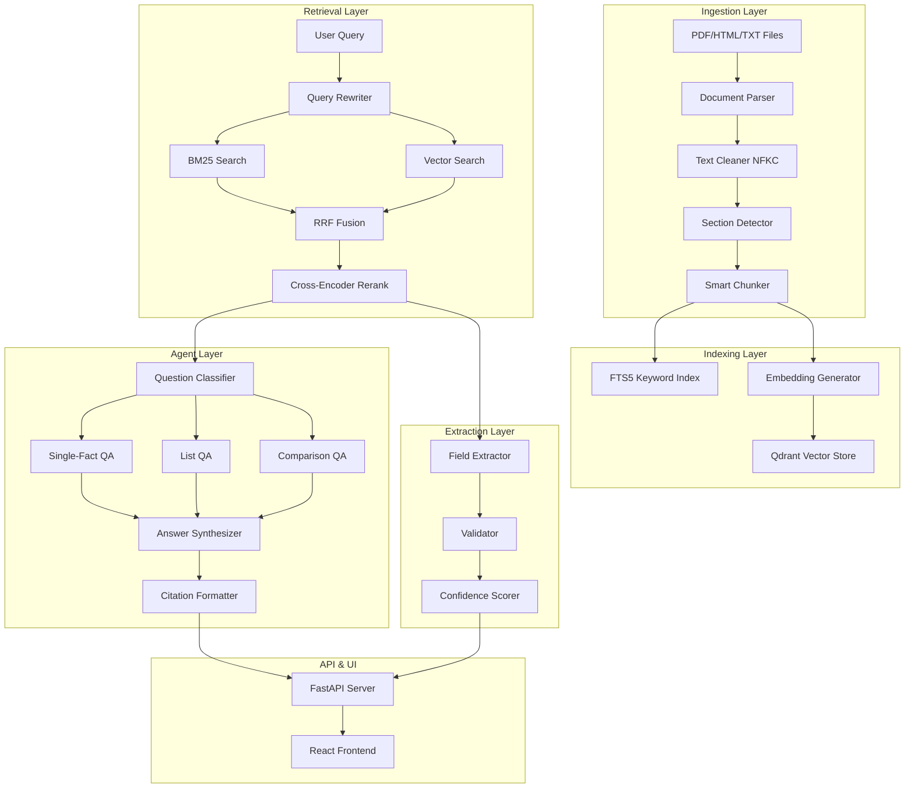

# RFP Intelligence Platform

A comprehensive platform for ingesting, indexing, searching, and extracting intelligence from RFP (Request for Proposal) documents using a RAG (Retrieval-Augmented Generation) pipeline with hybrid search and multi-agent Q&A.

## Table of Contents
- [Features](#features)
- [Architecture](#architecture)
- [Quick Start](#quick-start)
- [Installation](#installation)
- [Running the Pipeline](#running-the-pipeline)
- [API Endpoints](#api-endpoints)
- [Frontend (Web UI)](#frontend-web-ui)
- [Design Decisions](#design-decisions)
- [Known Limitations and Assumptions](#known-limitations-and-assumptions)
- [Deliverables](#deliverables)
- [Contributing](#contributing)
- [License](#license)

## Features

- **Document Ingestion**: Parse PDF, HTML, and text documents with NFKC normalization and structure detection
- **Smart Chunking**: Section-aware chunking with addendum detection and token counting
- **Hybrid Search**: BM25 keyword search + semantic vector search with Reciprocal Rank Fusion (RRF) and cross-encoder reranking
- **Multi-Agent Q&A**: Question classification, retrieval, and answer synthesis with citations
- **Field Extraction**: Automated extraction of key RFP fields with validation
- **Web Interface**: React-based dashboard for search, Q&A, document browsing, and extraction

## Architecture



## Quick Start

### Prerequisites
- Python 3.12+
- Node.js 18+ (for frontend)
- NVIDIA API key for embeddings and LLM (or compatible endpoint)

### Backend Setup
```bash
cd RFP_intelligence
python -m venv .venv
source .venv/bin/activate  # Windows: .venv\Scripts\activate
pip install -r requirements.txt

# Set environment variables
export NVIDIA_API_KEY="your-key"
export NVIDIA_BASE_URL="https://integrate.api.nvidia.com/v1"
export EMBED_MODEL="nvidia/nv-embedqa-e5-v5"
```

### Frontend Setup
```bash
cd frontend
npm install
npm run dev
# Frontend runs at http://localhost:3000
```

### Start Backend Server
```bash
cd RFP_intelligence
python start_backend.py
# API runs at http://localhost:8000
# API docs at http://localhost:8000/docs
```

## Installation

### Python Dependencies
```bash
pip install -r requirements.txt
```

Key dependencies:
- `fastapi`, `uvicorn` - API server
- `qdrant-client` - Vector database
- `pymupdf`, `pdfplumber` - PDF parsing
- `lxml`, `beautifulsoup4` - HTML parsing
- `sentence-transformers` - Embeddings (via NVIDIA API)
- `pydantic`, `pydantic-settings` - Configuration
- `typer` - CLI commands
- `pytest` - Testing

### Frontend Dependencies
```bash
cd frontend && npm install
```

Key dependencies:
- `react`, `react-dom`, `react-router-dom` - UI framework
- `axios` - API client
- `lucide-react` - Icons
- `vite` - Build tool

## Running the Pipeline

### 1. Ingest Documents
```bash
# Via CLI
python main.py index --path "data" --bid_id "Bid1"

# Via API
curl -X POST http://localhost:8000/ingest \
  -H "Content-Type: application/json" \
  -d '{"bid_id": "Bid1", "folder_path": "data/Bid1"}'
```

### 2. Index Documents (Generate Embeddings)
```bash
# Via CLI
python main.py index --bid_id "Bid1" --force

# Via API
curl -X POST http://localhost:8000/index \
  -H "Content-Type: application/json" \
  -d '{"bid_id": "Bid1", "force": true}'
```

### 3. Search Documents
```bash
# Via CLI
python main.py search "bid submission deadline" --bid_id "Bid1" --mode hybrid_rerank --top_k 5

# Via API
curl -X POST http://localhost:8000/search \
  -H "Content-Type: application/json" \
  -d '{"query": "bid submission deadline", "bid_ids": ["Bid1"], "top_k": 5, "mode": "hybrid_rerank"}'
```

### 4. Ask Questions (Q&A)
```bash
# Via CLI
python main.py ask Bid1 "What is the bid submission deadline?"

# Via API
curl -X POST http://localhost:8000/ask \
  -H "Content-Type: application/json" \
  -d '{"bid_id": "Bid1", "question": "What is the bid submission deadline?", "top_k": 5, "mode": "hybrid_rerank"}'
```

### 5. Extract Fields
```bash
# Via CLI
python main.py extract Bid1

# Via API
curl -X POST http://localhost:8000/extract/Bid1
```

### 6. View Q&A Log
```bash
python main.py qa_log
```

## API Endpoints

| Endpoint | Method | Description |
|----------|--------|-------------|
| `/health` | GET | Health check |
| `/bids` | GET | List all indexed bids |
| `/ingest` | POST | Ingest documents from folder |
| `/index` | POST | Index documents (generate embeddings) |
| `/search` | POST | Search documents |
| `/ask` | POST | Ask question about a bid |
| `/extract/{bid_id}` | POST | Extract fields from bid |
| `/documents/{bid_id}` | GET | List documents for a bid |
| `/chunks/{bid_id}/{file_name}` | GET | Get chunks for a document |
| `/upload` | POST | Upload files to bid folder |

### Search Modes
- `bm25` - Keyword-only search (BM25)
- `dense` - Semantic-only search (vector)
- `hybrid` - BM25 + Vector with RRF fusion
- `hybrid_rerank` - Hybrid + cross-encoder reranking (recommended)

## Frontend (Web UI)

The React frontend provides:
- **Dashboard** - Overview of bids and indexing status
- **Ingest** - Upload and index documents
- **Search** - Search across documents with mode selection
- **Ask** - Natural language Q&A with citations
- **Documents** - Browse indexed documents and chunks
- **Extraction** - View extracted fields and validation

```bash
cd frontend
npm run dev      # Development server at http://localhost:3000
npm run build    # Production build
npm run preview  # Preview production build
```

The frontend proxies API calls to `http://localhost:8000` via Vite proxy.

## Design Decisions

### Chunking Strategy
- **Section-aware chunking**: Preserves document structure (sections, addenda)
- **Addendum detection**: Special handling for "Addendum N" documents
- **Token counting**: Uses tiktoken for accurate token estimates
- **Overlap**: 100-token overlap between chunks for context continuity
- **Size limits**: 512 tokens max per chunk, 50 tokens minimum

### Embedding Model
- **Model**: `nvidia/nv-embedqa-e5-v5` (via NVIDIA API)
- **Asymmetric embeddings**: `input_type="passage"` for documents, `input_type="query"` for queries
- **Dimension**: 2048
- **Batch size**: 32 for efficient API usage

### Retrieval Strategy
1. **BM25 (FTS5)**: SQLite FTS5 with custom tokenizer (`tokenchars='_-'`) for keyword search
2. **Vector (Qdrant)**: HNSW index with cosine similarity for semantic search
3. **RRF Fusion**: Reciprocal Rank Fusion (k=60) combines BM25 and vector results
4. **Reranking**: Cross-encoder reranking for top-k fused results

### Agent Framework
- **Question Classification**: Rule-based classifier (single-fact, list, comparison, summary)
- **Retrieval Agent**: Query rewriting + hybrid search + reranking
- **QA Agents**: Specialized agents per question type
- **Citation Format**: Structured citations with chunk_id, file_name, page, quote

### Vector Store
- **Qdrant**: Local embedded mode (no separate server needed)
- **Payload**: chunk_id, file_name, doc_type, addendum_number, page_range, section, text
- **Filtering**: Bid-level filtering via payload

## Known Limitations and Assumptions

### Known Limitations

1. **Agent Layer Tests Incomplete**
   - Core/ingestion/search layers fully tested (23+ passing)

2. **PDF Parsing Edge Cases**
   - Complex tables may not extract perfectly
   - Scanned/image-only PDFs require OCR (not implemented)
   - Multi-column layouts may have reading order issues

3. **Scale Limitations**
   - Qdrant embedded mode suitable for ≤100K vectors
   - For production scale, use Qdrant cluster mode
   - FTS5 performance degrades beyond ~1M chunks

4. **Embedding API Dependency**
   - Requires NVIDIA API key (or compatible endpoint)
   - No local embedding fallback implemented
   - Rate limiting handled but may cause delays

5. **Cross-Encoder Reranking**
   - Uses NVIDIA rerank API (additional latency ~200-500ms)
   - Can be disabled via `mode=hybrid` for faster results

6. **Frontend Limitations**
   - No authentication/authorization implemented
   - Single-user design (no multi-tenancy)
   - WebSocket support not implemented for real-time updates

7. **Data Persistence**
   - SQLite for keyword index (single-writer)
   - Qdrant local storage in `storage/qdrant/`
   - No automated backup/restore

### Assumptions

1. **Document Format**
   - RFP documents follow standard procurement formats
   - Addenda named with "Addendum N" pattern
   - PDFs are text-extractable (not scanned images)

2. **Query Patterns**
   - Questions are in English
   - Domain-specific terminology (RFP, procurement, bidding)
   - Users understand search mode tradeoffs

3. **Infrastructure**
   - Single-machine deployment (embedded Qdrant)
   - NVIDIA API available with valid credentials
   - Sufficient RAM for embedding batch processing (≥8GB)

4. **Data Model**
   - One bid per folder in `data/{bid_id}/`
   - Bid IDs are unique alphanumeric strings
   - Chunk IDs are deterministic (content hash)

5. **Quality Expectations**
   - Confidence scores are heuristic (0.0-1.0)
   - Citations may include context beyond exact answer
   - Reranking improves precision but adds latency

## Deliverables

### JSON Output Files (per bid folder)
Located in `outputs/json/`:
- `Bid1_extraction.json` - Extracted fields with citations and confidence
- `Bid2_extraction.json` - Extracted fields with citations and confidence

### Retrieval Evaluation Report
- `outputs/evaluation/retrieval_report.md` - Recall@k and MRR results for each configuration

### Sample Q&A Log
- `outputs/qa_log.json` - 10+ questions with cited answers

### Agent Trace
- `outputs/traces/extraction_trace.json` - Full extraction run trace

### Architecture Diagram
- Included above in [Architecture](#architecture) section (Mermaid)

## Contributing

1. Fork the repository
2. Create a feature branch
3. Make changes with tests
4. Run test suite: `python -m pytest tests/test_core.py tests/test_ingestion.py tests/test_search.py -v`
5. Submit pull request

## License

MIT License - see LICENSE file for details.

---

*RFP Intelligence Platform - Built for procurement intelligence automation*
